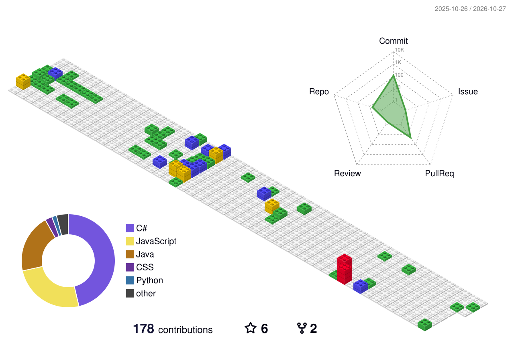

<h1 align="center">João Vitor</h1>

  Desenvolvedor Back End · Java · C#

---

---

## Sobre

- Desenvolvedor back end com foco em Java/Spring Boot e C#/ASP.NET Core
- Gosto de aprender na prática, construindo APIs e projetos completos
- Cursando Engenharia de Software na UFBRA (previsão: 2030)
- Graduado em Análise e Desenvolvimento de Sistemas pela Universidade Sumaré
- Técnico em Desenvolvimento de Sistemas pelo Senai Suíço Brasileiro

## Tecnologias
<!-- 

-->
<picture>
  <source media="(prefers-color-scheme: light)" srcset="https://skillicons.dev/icons?i=java,spring,maven,cs,dotnet,mysql,postgres,mongodb,supabase,docker,react,js,html,css,git,github,vercel,postman,linux,vscode&theme=light&perline=10">
  
</picture>

## Projetos em destaque

- [Desafio Itaú](https://github.com/JoaoVGomees/desafio-backend-itau) – API REST em Java com Spring, seguindo os requisitos propostos pelo Itaú.
- [Gerenciador de Ordens de Serviço](https://github.com/carlitos9087/Gerenciador-De-Ordens-De-Servico) – API desenvolvida como projeto final do curso no Senac.
- [API AnimeLink](https://github.com/JoaoVGomees/APICompleta) – Back end do AnimeLink, projeto final do curso técnico.
- [Weather Page](https://weatherpageapi.vercel.app/) – Plataforma para consultar o clima da sua cidade.
- [Bikcraft](https://joaovgomees.github.io/bikcraft/) – Página de aluguel de bicicletas elétricas (back end em desenvolvimento).

## Contato

- [LinkedIn](https://www.linkedin.com/in/joaovgomees/)
- [Portfólio](https://joaovgomes.com.br/)
- [Instagram](https://www.instagram.com/__joao78)

## Spotify

---
